# Файловая система Linux · отчёт

ФИО: Товстенко Оскар
Группа: 9/2-РПО-25/1
Дата: 23.10.2026
Среда: Ubuntu 26.04.1 LTS в VirtualBox, пользователь `vboxuser`

Команды и выводы ниже сняты в этой виртуальной машине. Часть шагов лабораторной (`linux-fhs-lab`) на снимках не получилась: каталога с учебными файлами в домашнем каталоге не было. Эти места отмечены в результате.

## Корневой каталог

Команды:

```bash
pwd
ls -lah /
```

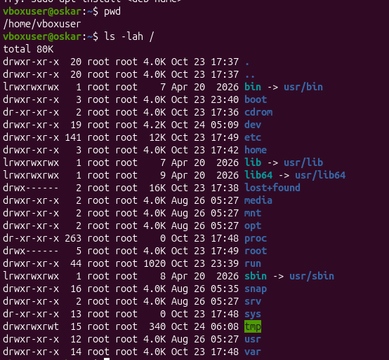

Результат: `pwd` показал `/home/vboxuser`. `ls -lah /` вывел каталоги верхнего уровня: `bin`, `boot`, `dev`, `etc`, `home`, `lib`, `media`, `mnt`, `opt`, `proc`, `root`, `run`, `sbin`, `snap`, `srv`, `sys`, `tmp`, `usr`, `var`. У `bin`, `lib`, `lib64` и `sbin` стоят символические ссылки на каталоги внутри `usr`.

Что такое корневой каталог, чем абсолютный путь отличается от относительного.

Вывод: `/` — корень дерева файлов, от него начинаются все абсолютные пути. Абсолютный путь записывается от `/` (`/home/vboxuser`). Относительный считается от текущего каталога (`Documents`, `../`).

## Домашний каталог

Команды:

```bash
cd ~
pwd
ls -a
```

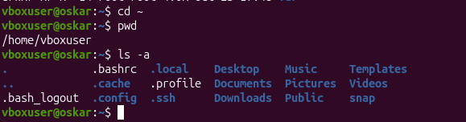

Результат: текущий каталог — `/home/vboxuser`. `ls -a` показал обычные каталоги (`Desktop`, `Documents`, `Downloads`, `Music`, `Pictures`, `Public`, `Templates`, `Videos`, `snap`) и скрытые файлы: `.bashrc`, `.bash_logout`, `.cache`, `.config`, `.local`, `.profile`, `.ssh`.

Где находится домашний каталог, что такое скрытые файлы.

Вывод: домашний каталог пользователя — `/home/vboxuser`, на него же указывает `~`. Скрытые имена начинаются с точки, обычный `ls` их не показывает, `ls -a` показывает.

## Каталог /etc

Команды:

```bash
cat /etc/os-release
```

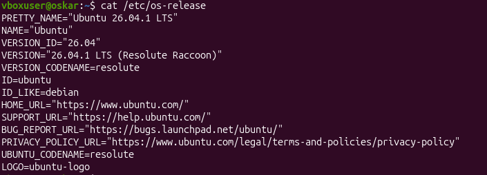

Результат: система — Ubuntu 26.04.1 LTS, кодовое имя Resolute Raccoon, `ID=ubuntu`, `ID_LIKE=debian`. Команда `getent passwd` на снимке не запускалась, поэтому UID, домашний каталог учётной записи и оболочка по этому снимку не видны.

Версия системы, UID, домашний каталог и оболочка.

Вывод: `/etc` хранит настройки системы, в том числе файл `os-release`. Учётные записи лежат в `/etc/passwd`: у `root` UID равен 0, у обычного пользователя UID обычно от 1000, домашний каталог — поле с `/home/...`, оболочка — последнее поле (часто `/bin/bash`). Эти поля нужно добрать командой `getent passwd` и заменить снимок.

## Программы и PATH

Команды:

```bash
command -v
type
echo $PATH
```

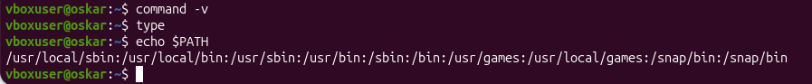

Результат: `command -v` и `type` набраны без имени программы, видимого ответа на снимке нет. `echo $PATH` вывел:

`/usr/local/sbin:/usr/local/bin:/usr/sbin:/usr/bin:/sbin:/bin:/usr/games:/usr/local/games:/snap/bin:/snap/bin`

Как оболочка находит программу.

Вывод: если команда не встроенная, оболочка ищет исполняемый файл по каталогам из `$PATH` слева направо. Встроенные команды оболочки (`echo`, `cd`, `type`) выполняются без этого поиска. Чтобы это было видно на снимке, нужны `command -v echo` и `type echo` (или `type ls`).

## Изменяемые данные

Команды:

```bash
ls /var
findmnt -T /run
```

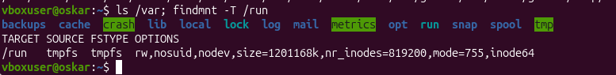

Результат: в `/var` есть `backups`, `cache`, `crash`, `lib`, `local`, `lock`, `log`, `mail`, `opt`, `run`, `snap`, `spool`, `tmp`. Для `/run` `findmnt` показал `tmpfs` с параметрами `rw,nosuid,nodev`, размер около 1,2 ГБ.

Назначение `/var/lib`, `/var/log`, `/var/cache` и `/run`.

Вывод: `/var` — изменяемые данные во время работы системы. `/var/lib` — постоянные данные приложений, `/var/log` — журналы, `/var/cache` — данные, которые можно пересоздать. `/run` — tmpfs в памяти: сведения о текущем запуске, после перезагрузки каталог пустой.

## Устройства

Команды:

```bash
ls -l /dev/null
echo $?
```

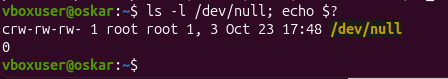

Результат: `/dev/null` — `crw-rw-rw-`, владелец `root`, номера устройства `1, 3`. Код завершения предыдущей команды — `0`.

Тип устройства и код завершения.

Вывод: буква `c` в начале прав означает символьное устройство. `/dev` — каталог файлов устройств, а не обычных дисковых файлов. Код `0` — команда завершилась без ошибки, ненулевой код — ошибка.

## Файлы /proc

Команды:

```bash
cat /proc/uptime
cp
sleep 5
```

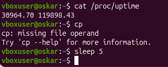

Результат: `/proc/uptime` показал `30964.70 119898.43` (секунды с загрузки и сумма времени процессоров). Дальше `cp` вызван без имён файлов и ответил `missing file operand`. `sleep 5` отработал, но копию файла на снимке не создавали и повторно не читали.

Почему копия не меняется.

Вывод: `/proc` — виртуальная файловая система ядра, значение в `uptime` меняется само. Обычная копия, сделанная `cp /proc/uptime uptime.txt`, уже не связана с ядром и остаётся прежней. Этот шаг на снимке не выполнен: нужно скопировать файл, подождать и сравнить `cat /proc/uptime` с `cat uptime.txt`.

## Сетевые интерфейсы

Команды:

```bash
ls /sys/class/net
```

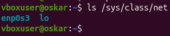

Результат: в системе два интерфейса — `enp0s3` и `lo`.

Какие интерфейсы есть в системе.

Вывод: `/sys` даёт доступ к объектам ядра. `lo` — локальная петля (loopback), `enp0s3` — сетевой адаптер виртуальной машины.

## inode и ссылки

Команды:

```bash
ls -li
rm data/info.txt
cat info-link.txt
```

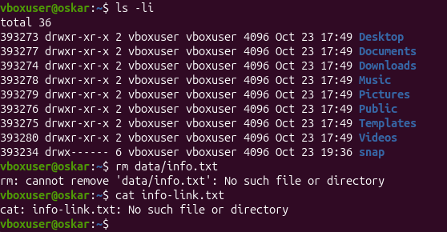

Результат: `ls -li` выполнен в домашнем каталоге и показал inode каталогов (`Desktop` — 393273, `Documents` — 393274 и дальше). Число ссылок у этих каталогов равно 2. Команды `rm data/info.txt` и `cat info-link.txt` завершились ошибкой `No such file or directory`: рабочего каталога лабораторной с файлом и ссылками не было.

Чем жёсткая ссылка отличается от символической.

Вывод: жёсткая ссылка — ещё одно имя того же inode, поэтому данные живут, пока остаётся хотя бы одно имя. Символическая ссылка хранит путь; если исходный файл удалить, ссылка остаётся, но открыть её нельзя. На этом снимке разница не показана: ссылки нужно создать в `~/linux-fhs-lab` и снять команды заново.

## Место на диске

Команды:

```bash
findmnt /
df -h .
du -sh data
```

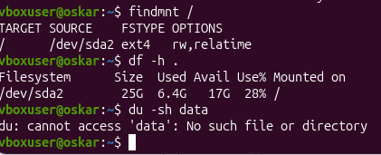

Результат: корень `/` — это `/dev/sda2`, файловая система `ext4`, параметры `rw,relatime`. `df -h .` показал раздел 25 ГБ, занято 6,4 ГБ, свободно 17 ГБ, использование 28%. `du -sh data` не выполнился: каталога `data` нет.

Чем `df` отличается от `du`.

Вывод: `df` показывает размер файловой системы и свободное место на разделе. `du` считает, сколько места занимает конкретный каталог или файл. Для снимка нужен `du` по существующему каталогу, например по каталогу лабораторной.

## Монтирование tmpfs

Команды:

```bash
findmnt -T mount-demo
```


Результат: команда ничего не вывела. Каталог `mount-demo` не является точкой монтирования, tmpfs на него не подключали.

Почему `before.txt` перестал быть виден.

Вывод: новая файловая система, смонтированная поверх каталога, закрывает его прежнее содержимое. Файл `before.txt` остаётся на диске, но через точку монтирования его не видно, пока сверху лежит tmpfs. В этой сессии монтирование не делалось, поэтому эффект на снимке не виден. Если `mount` недоступен без прав администратора, в отчёт нужно вставить текст ошибки.

## Отключение tmpfs

Команды:

```bash
cat mount-demo/before.txt
```

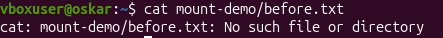

Результат: `cat: mount-demo/before.txt: No such file or directory`. Каталога `mount-demo` нет, размонтировать было нечего.

Что стало с `inside.txt`.

Вывод: файл, созданный внутри tmpfs, лежит в памяти и исчезает при размонтировании. Файл, который был на диске под точкой монтирования, после `umount` снова виден. Здесь этого шага не было.

## Файлы shop-api

Команды на отдельном снимке нет. Файл `screenshots/13-model.png` — та же картинка, что и снимок отключения tmpfs: снова `cat mount-demo/before.txt` с ошибкой «нет такого файла». `find model-root -type f` не запускался.


Почему выбран каждый каталог.

Вывод по правилам FHS из лекции, без переноса файлов в системные каталоги. Модель собирается внутри `model-root`, чтобы не менять настоящие `/etc` и `/var`:

| Файл | Каталог | Основание |
|---|---|---|
| Исполняемый файл, установленный вручную | `/usr/local/bin` | программы вне пакетов дистрибутива |
| Настройки | `/etc/shop-api` | конфигурационные файлы |
| База данных | `/var/lib/shop-api` | постоянные изменяемые данные приложения |
| Журнал | `/var/log/shop-api` | журналы служб |
| Номер процесса | `/run/shop-api` | сведения о работающей службе, до перезагрузки |
| Промежуточные файлы | `/tmp` | временные данные |

В рабочей копии это те же уровни: `model-root/usr/local/bin`, `model-root/etc/shop-api`, `model-root/var/lib/shop-api`, `model-root/var/log/shop-api`, `model-root/run/shop-api`. Этот каталог нужно создать и снять `find model-root -type f` вместо текущего 13-го снимка.

## Итоговая задача

Пути службы shop-api. В системе ничего не перемещалось.

| Путь | Оставить / заменить | Правильный путь | Основание |
|---|---|---|---|
| `/home/admin/shop.log` | Заменить | `/var/log/shop-api/shop.log` | Журнал службы лежит в `/var/log`, а не в домашнем каталоге администратора. |
| `/usr/bin/config.json` | Заменить | `/etc/shop-api/config.json` | Настройки хранятся в `/etc`. Рядом с программой в `/usr/bin` их не кладут: обновление программы затрёт конфиг. |
| `/tmp/database.db` | Заменить | `/var/lib/shop-api/database.db` | База — постоянные данные. `/tmp` очищается и не подходит для хранения базы. |
| `/etc/shop-api/app.conf` | Оставить | `/etc/shop-api/app.conf` | Конфигурация приложения уже в `/etc/shop-api`. |
| `/var/log/shop-api/access.log` | Оставить | `/var/log/shop-api/access.log` | Журнал службы уже в `/var/log/shop-api`. |
| `/var/lib/shop-api/database.db` | Оставить | `/var/lib/shop-api/database.db` | Постоянные данные приложения уже в `/var/lib/shop-api`. |

## Таблица каталогов для службы backup-agent

| Файл | Каталог | Основание |
|---|---|---|
| Программа | `/usr/local/bin/backup-agent` | Исполняемый файл, установленный вручную, а не из пакета дистрибутива. |
| Настройки | `/etc/backup-agent/config.conf` | Конфигурация службы хранится отдельно от программы, в `/etc`. |
| Журнал | `/var/log/backup-agent/backup.log` | Журналы служб ищут в `/var/log`. |
| Список сделанных копий | `/var/lib/backup-agent/index.db` | Постоянные изменяемые данные приложения — в `/var/lib`. |
| Номер процесса | `/run/backup-agent.pid` | PID относится к текущему запуску и живёт в `/run` до перезагрузки. |
| Сами резервные копии | `/srv/backup/` | Копии — данные, которые система обслуживает для пользователей. Их держат на постоянном носителе, отдельном от `/tmp` и от каталога программы. Внешний диск можно смонтировать в `/mnt/backup` или в `/srv/backup`. |

## Практическая работа

Код теста по занятию 3 сюда не вставлен: его нужно получить самому на странице теста и дописать одной строкой.

https://algorthimization-course-vvodnoe.vercel.app/op05-operacionnye-sistemy-i-sredy/testy/tema-03/index.html

## Перед сдачей

- [ ] tmpfs отключена или ошибка `mount` вписана в отчёт. Сейчас каталог `mount-demo` не создавался.
- [+] Снимки открываются из этого файла.
- [ ] Все результаты получены по шагам лабораторной. Снимки 01, 02, 05, 06, 08 и часть 03, 04, 10 — из этой Ubuntu. Снимки 07, 09, 11, 12 и 13 шаги лабораторной не показывают.
- [ ] Код практики-теста вставлен в отчёт.
- [ ] Работа сохранена на внешнем носителе.
