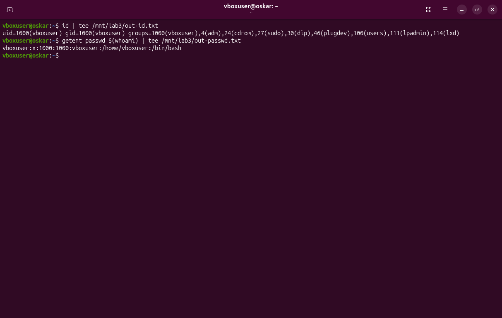
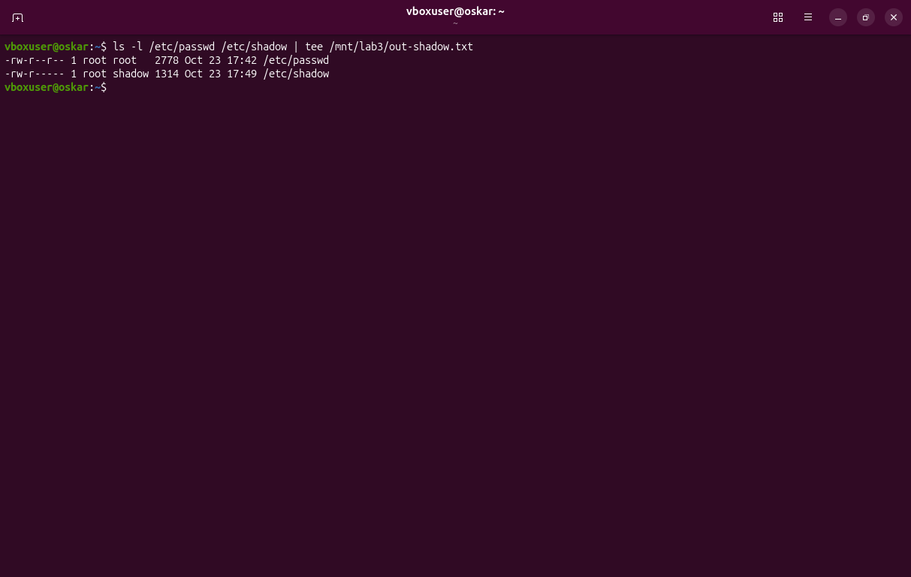
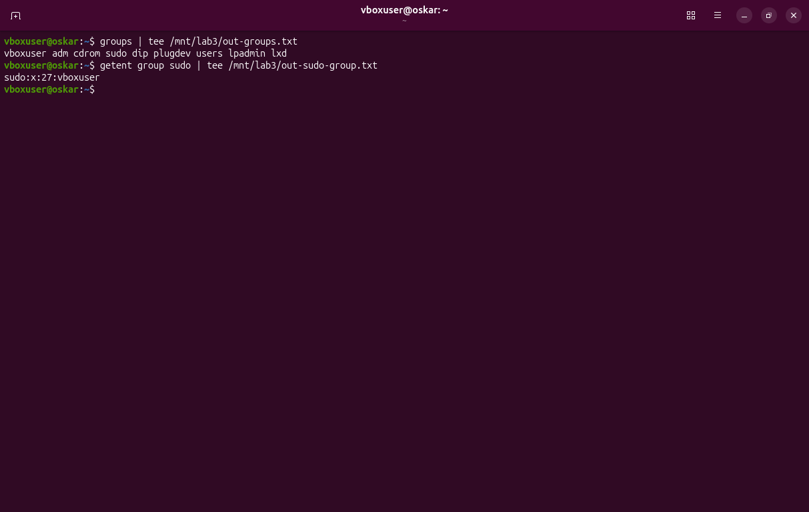
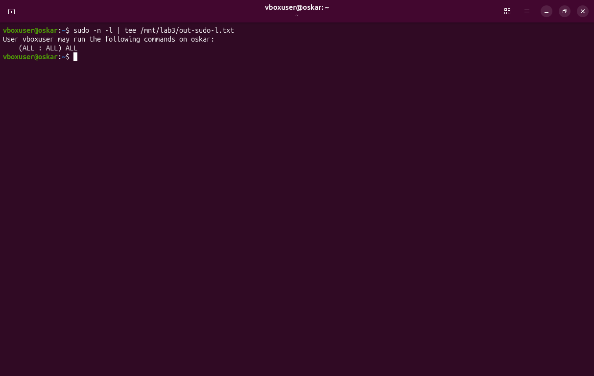
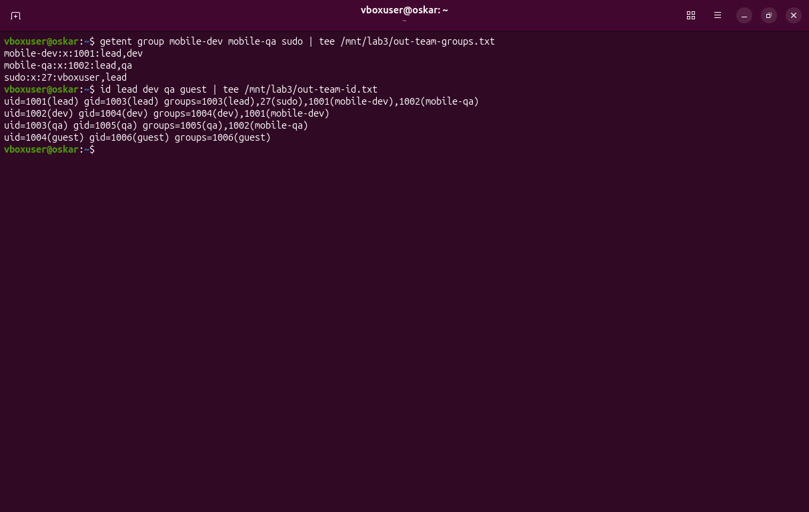
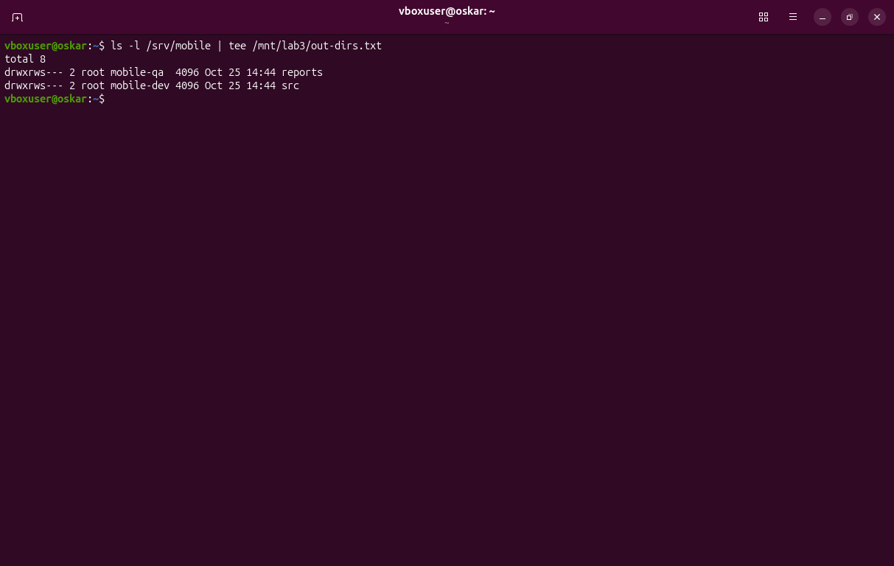
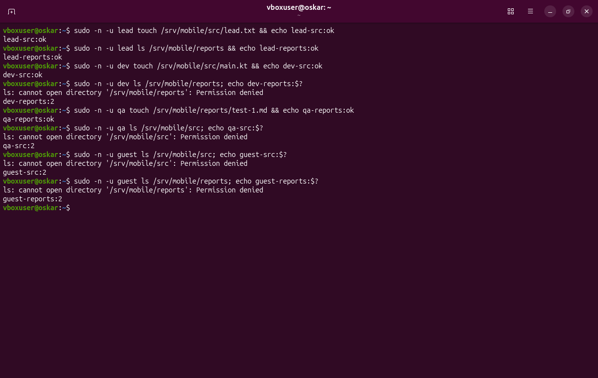
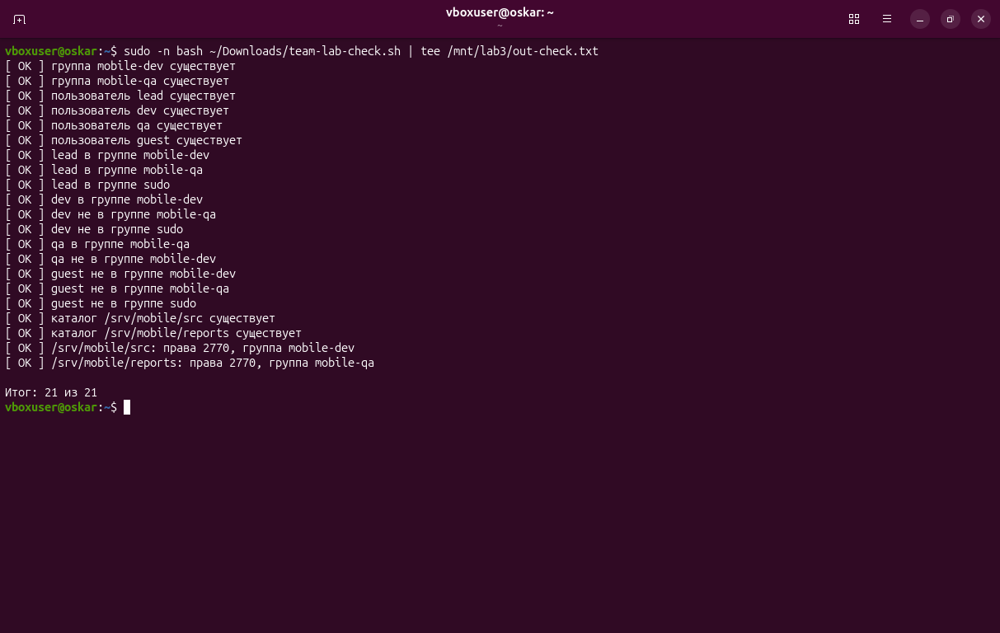
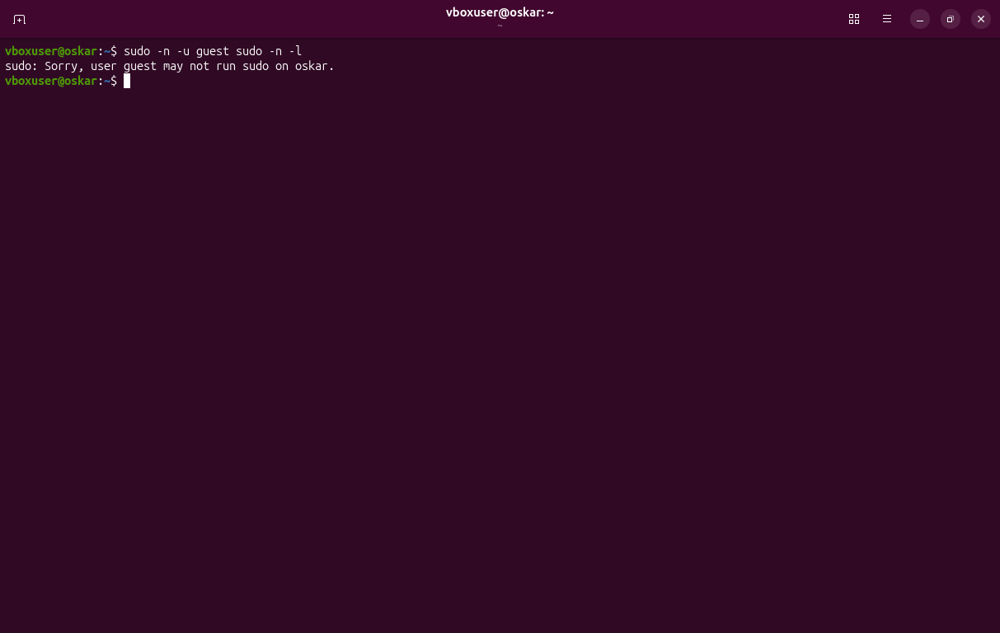
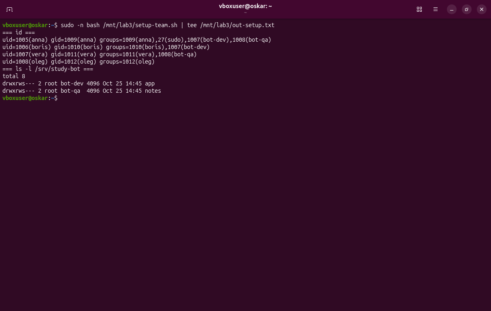

# Пользователи, группы и sudo · отчёт

ФИО: Товстенко Оскар
Группа: 9/2-РПО-25/1
Дата: 25.10.2026
Среда: Ubuntu 26.04.1 LTS, VirtualBox, пользователь `vboxuser`

## Учётная запись

Команды:

```bash
id
getent passwd $(whoami)
```



Результат: `uid=1000(vboxuser) gid=1000(vboxuser)`, дополнительные группы `adm, cdrom, sudo, dip, plugdev, users, lpadmin, lxd`. Строка passwd: `vboxuser:x:1000:1000:vboxuser:/home/vboxuser:/bin/bash`.

Подпишите семь полей своей строки /etc/passwd.

Вывод: семь полей через двоеточие. 1) имя `vboxuser`. 2) пароль `x` — сам хеш лежит не здесь, а в shadow. 3) UID `1000`. 4) GID основной группы `1000`. 5) комментарий `vboxuser`. 6) домашний каталог `/home/vboxuser`. 7) оболочка `/bin/bash`.

## passwd и shadow

Команды:

```bash
ls -l /etc/passwd /etc/shadow
```



Результат: `/etc/passwd` — `-rw-r--r--`, владелец `root`, группа `root`. `/etc/shadow` — `-rw-r-----`, владелец `root`, группа `shadow`.

Почему shadow закрыт для остальных пользователей.

Вывод: в shadow лежат хеши паролей. Если файл читает любой пользователь, хеши можно забрать и подбирать офлайн. Поэтому читать его могут только root и группа `shadow`. В passwd на месте пароля стоит `x`.

## Группы

Команды:

```bash
groups
getent group sudo
```



Результат: `groups` вывел `vboxuser adm cdrom sudo dip plugdev users lpadmin lxd`. Группа sudo: `sudo:x:27:vboxuser`.

Где основная группа, где дополнительные.

Вывод: основная группа — `vboxuser`, GID 1000. Она записана в четвёртом поле passwd и в `gid=` у `id`. Остальные группы дополнительные. Новые файлы получают основную группу, если каталог без setgid. Доступ к файлам дают и основная, и дополнительные группы.

## Правила sudo

Команды:

```bash
sudo -l
```



Результат: на машине `oskar` пользователю `vboxuser` разрешено `(ALL : ALL) ALL`.

Какое правило даёт вам права администратора.

Вывод: правило `(ALL : ALL) ALL` разрешает любую команду от имени любого пользователя. Оно действует, потому что `vboxuser` входит в группу `sudo`. Пароль при этом спрашивается у самого пользователя, а не выдаётся постоянный вход под root.

## Команда mobile-app

Команды:

```bash
getent group mobile-dev mobile-qa sudo
id lead dev qa guest
```



Результат: `mobile-dev` — lead и dev, `mobile-qa` — lead и qa, в `sudo` вместе с `vboxuser` есть lead. У guest в `id` только группа `guest`.

Совпадают ли группы со схемой ролей.

Вывод: совпадают. lead работает с кодом и отчётами и администрирует систему. dev только в `mobile-dev`. qa только в `mobile-qa`. guest не входит ни в проектные группы, ни в sudo.

## Каталоги проекта

Команды:

```bash
ls -l /srv/mobile
```



Результат: `src` — `drwxrws---`, группа `mobile-dev`. `reports` — `drwxrws---`, группа `mobile-qa`. Числовой режим обоих каталогов `2770`.

Что означает каждая цифра в 2770.

Вывод: `2` — setgid, новый файл наследует группу каталога, а не основную группу автора. `7` — владельцу rwx. `7` — группе rwx. `0` — остальным ничего. Поэтому dev пишет в `src` и не открывает `reports`.

## Тесты доступа

Команды:

```bash
sudo -u lead touch /srv/mobile/src/lead.txt
sudo -u lead ls /srv/mobile/reports
sudo -u dev touch /srv/mobile/src/main.kt
sudo -u dev ls /srv/mobile/reports
sudo -u qa touch /srv/mobile/reports/test-1.md
sudo -u qa ls /srv/mobile/src
sudo -u guest ls /srv/mobile/src
sudo -u guest ls /srv/mobile/reports
```



Результат: lead создал файл в `src` и открыл `reports`. dev создал `main.kt` и получил `Permission denied` на `reports`. qa создал `test-1.md` и получил `Permission denied` на `src`. guest получил `Permission denied` на оба каталога. Код отказа `ls` — 2.

Результаты таблицы тестов доступа.

Вывод: фактический результат совпал с ожидаемым по схеме ролей. Таблица целиком — в `access-tests.md`.

## Проверка

Команды:

```bash
sudo bash ~/Downloads/team-lab-check.sh
```



Результат: все 21 пункт `[ OK ]`, строка `Итог: 21 из 21`.

Итог проверки; какие пункты потребовали исправления.

Вывод: исправлять схему не пришлось. Группы, учётные записи, членство и права `2770` сошлись с первого запуска.

## Отказ sudo в журнале

Команды:

```bash
sudo -n -u guest sudo -n -l
```



Результат: `sudo: Sorry, user guest may not run sudo on oskar.` Время на снимке — 25 октября, 14:53. Команда, которую пытались выполнить от имени guest, — `sudo -l`.

Кто, когда и какую команду пытался выполнить.

Вывод: guest не входит в sudo, поэтому список прав ему не показывают. В Ubuntu 26.04 текст отказа — `Sorry, user guest may not run sudo on oskar.`, а не старая фраза `NOT in sudoers`. Смысл тот же: чужая учётная запись не получает права администратора.

## Почему постоянная работа под root опасна

1. Ошибка в команде удаления под root не останавливается правами каталога и может стереть систему.
2. Чужая root-сессия открывает `/etc/shadow` и любую учётную запись. Обычному пользователю shadow закрыт.
3. Общий вход под root не оставляет в журнале имя человека. `sudo` пишет, кто запустил команду, поэтому отказ guest виден отдельно.

## Свой проект

Модель бота конспектов, скрипт и пять тестов — в `access-model.md` и `setup-team.sh`. Снимок вывода `id` и `ls -l` после запуска скрипта:



## Перед сдачей

- [+] Проверка: 21 из 21.
- [+] access-tests.md заполнен.
- [+] Учебные учётные записи удалены.
