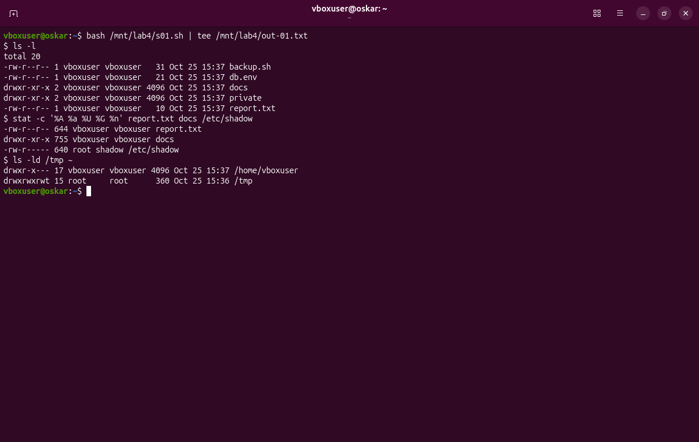
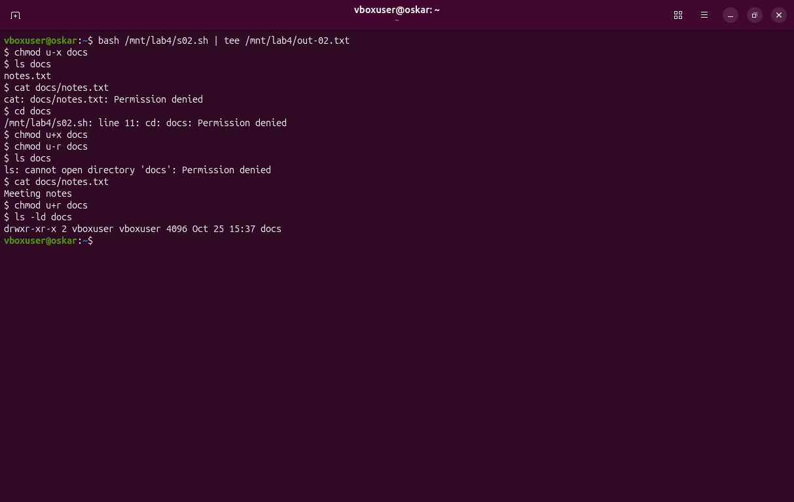
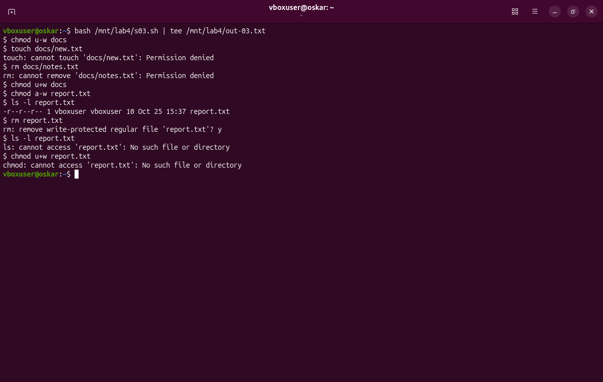
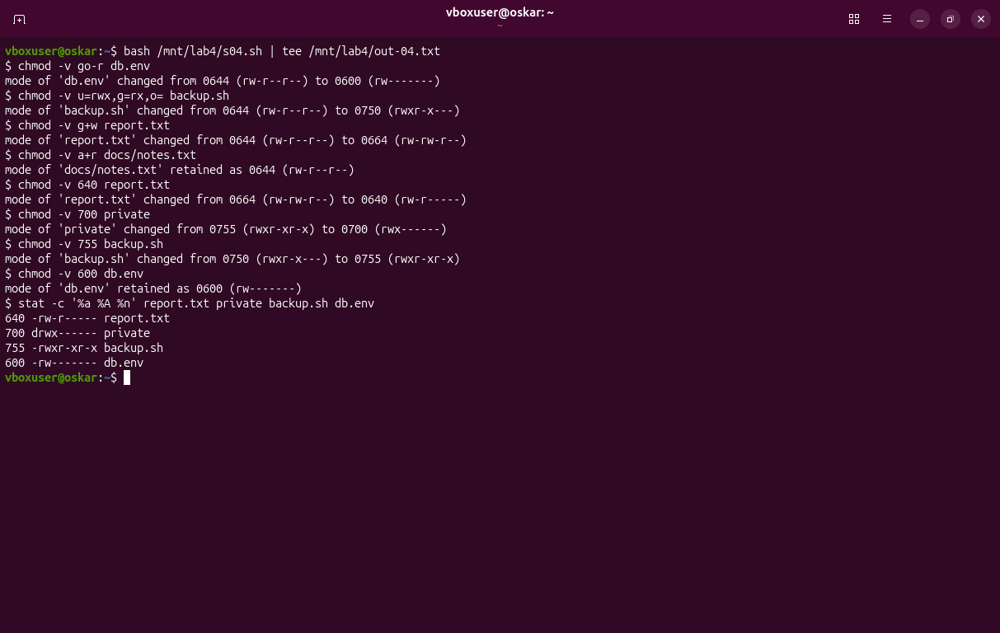
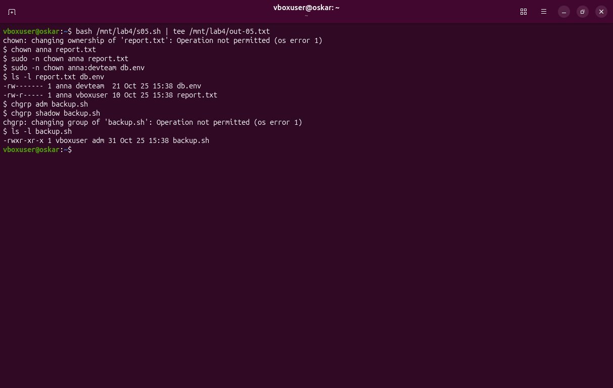
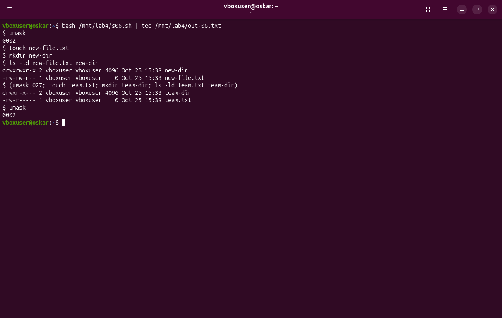
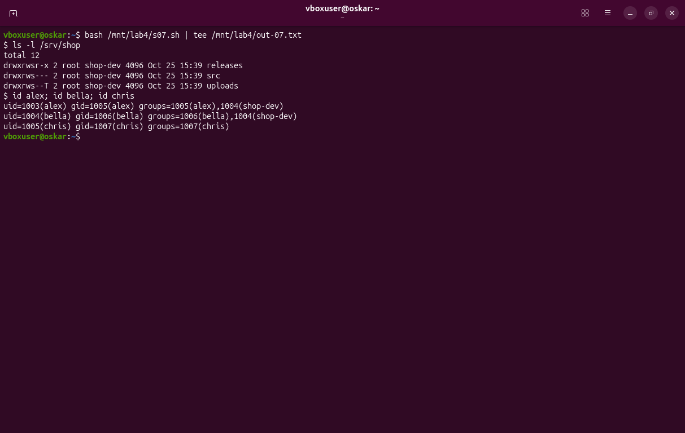
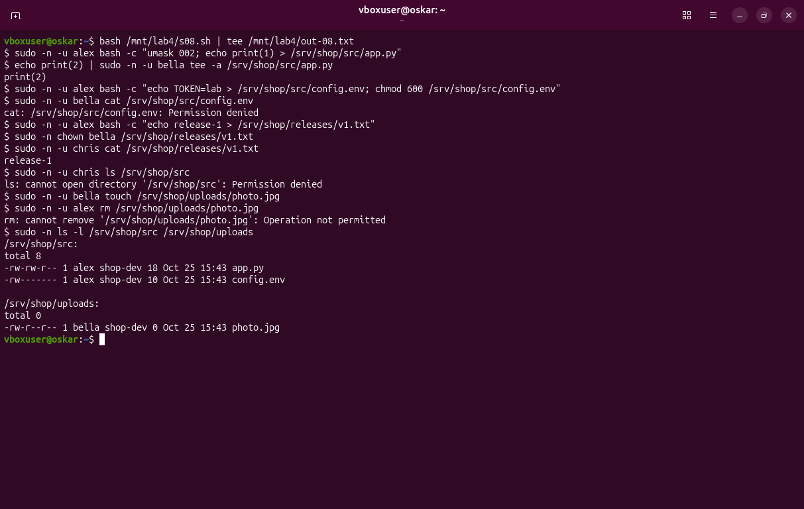
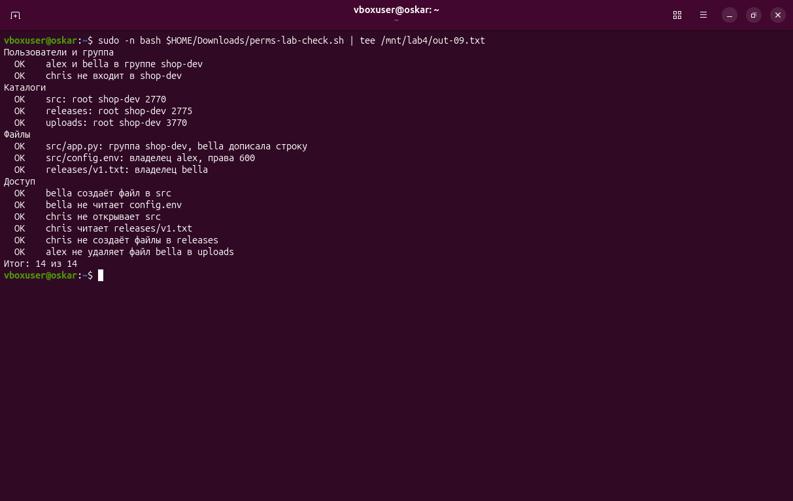

# Права доступа, владельцы и umask · отчёт

ФИО: Товстенко Оскар
Группа: 9/2-РПО-25/1
Дата: 25.10.2026
Среда: Ubuntu 26.04.1 LTS, VirtualBox, пользователь `vboxuser`

## Строка ls -l

Команды:

```bash
ls -l
stat -c '%A %a %U %G %n' report.txt docs /etc/shadow
ls -ld /tmp ~
```



Результат: у `report.txt` строка `-rw-r--r-- 1 vboxuser vboxuser 10 Oct 25 15:37 report.txt`. `stat` дал `644` для отчёта, `755` для `docs` и `640` для `/etc/shadow`. Домашний каталог: `drwxr-x---`. `/tmp`: `drwxrwxrwt`.

Подпишите поля одной строки: тип, три тройки, владелец, группа.

Вывод: в строке `report.txt` первый знак `-` — это обычный файл. Дальше три тройки `rw-` `r--` `r--`: владелец читает и пишет, группа и остальные только читают. Владелец и группа — `vboxuser`. Число ссылок `1`, размер `10` байт, имя в конце. У `/etc/shadow` тройки `rw-` `r--` `---`, владелец `root`, группа `shadow`: хеши паролей группе `shadow` видны, остальным нет. Буква `t` в конце `/tmp` — sticky-бит.

## Каталог без x и без r

Команды:

```bash
chmod u-x docs
ls docs
cat docs/notes.txt
cd docs
chmod u+x docs
chmod u-r docs
ls docs
cat docs/notes.txt
```



Результат: без `x` команда `ls docs` показала имя `notes.txt`, а `cat docs/notes.txt` и `cd docs` ответили `Permission denied`. Без `r`, но с возвращённым `x`, `ls` написал `cannot open directory`, а `cat docs/notes.txt` вывел `Meeting notes`.

Объясните каждую ошибку: что запрещено без x и без r.

Вывод: `x` у каталога — это право прохода. Без него известное имя ещё видно в списке, но открыть файл и войти в каталог нельзя. `r` — это право прочитать список имён. Без него `ls` каталог не открывает, но файл по уже известному имени читается, потому что проход `x` на месте.

## Удаление и право w

Команды:

```bash
chmod u-w docs
touch docs/new.txt
rm docs/notes.txt
chmod u+w docs
chmod a-w report.txt
rm report.txt
```



Результат: без `w` на `docs` и `touch`, и `rm docs/notes.txt` получили `Permission denied`. После возврата `w` файл `report.txt` стал `-r--r--r--`. `rm` спросил подтверждение, потому что файл защищён от записи, и после `y` удалил его.

Почему удаление файла решает каталог, а не файл.

Вывод: имя файла лежит в каталоге. Удаление меняет этот каталог, поэтому нужно `w` на каталог, а не на сам файл. Запрет записи на `report.txt` не спас его: каталог был доступен на запись, и имя из него убрали.

## chmod буквами и числом

Команды:

```bash
chmod -v go-r db.env
chmod -v u=rwx,g=rx,o= backup.sh
chmod -v g+w report.txt
chmod -v 640 report.txt
chmod -v 700 private
chmod -v 755 backup.sh
chmod -v 600 db.env
```



Результат: `go-r` перевёл `db.env` из `0644` (`rw-r--r--`) в `0600` (`rw-------`). `u=rwx,g=rx,o=` поставил `backup.sh` в `0750` (`rwxr-x---`). `g+w` сделал из `0644` число `0664` (`rw-rw-r--`). Число `640` вернуло `rw-r-----`, `700` закрыло `private` до `rwx------`, `755` открыло скрипт до `rwxr-xr-x`. `600` для `db.env` уже стояло, `chmod` так и написал: `retained`.

Переведите три своих примера из букв в число и обратно.

Вывод:

| Буквы | Число | Что изменилось |
|---|---|---|
| `go-r` от `rw-r--r--` | `600` · `rw-------` | у группы и остальных снято чтение |
| `u=rwx,g=rx,o=` | `750` · `rwxr-x---` | владелец всё, группа чтение и запуск, остальным ничего |
| `640` | `rw-r-----` | владелец `rw-` = 6, группа `r--` = 4, остальные `---` = 0 |

Обратный перевод `755` — `rwxr-xr-x`: `7` это `rwx`, `5` это `r-x`.

## Владелец и группа

Команды:

```bash
chown anna report.txt
sudo chown anna report.txt
sudo chown anna:devteam db.env
chgrp adm backup.sh
chgrp shadow backup.sh
```



Результат: `chown anna report.txt` без sudo — `Operation not permitted`. С sudo владелец `report.txt` стал `anna`, а у `db.env` владелец `anna` и группа `devteam`. `chgrp adm backup.sh` прошёл, группа стала `adm`. `chgrp shadow backup.sh` — снова `Operation not permitted`, группа осталась `adm`.

Почему chown без sudo запрещён, а chgrp на свою группу разрешён.

Вывод: смена владельца отдаёт файл другому человеку, это разрешено только root. Сменить группу своего файла можно на ту группу, в которой сам состоишь. `vboxuser` входит в `adm`, поэтому `chgrp adm` принят. В `shadow` он не входит, поэтому система отказала.

## umask

Команды:

```bash
umask
touch new-file.txt
mkdir new-dir
ls -ld new-file.txt new-dir
(umask 027; touch team.txt; mkdir team-dir; ls -ld team.txt team-dir)
```



Результат: текущая маска `0002`. Новый файл получил `-rw-rw-r--`, новый каталог `drwxrwxr-x`. В подоболочке с маской `027` файл стал `-rw-r-----`, каталог `drwxr-x---`. После подоболочки маска снова `0002`.

Права файла и каталога при маске 0027 — расчёт по тройкам.

Вывод: у файла база `666`, у каталога `777`. Маска `027` по тройкам — `000`, `010`, `111`: у владельца ничего не снимается, у группы снимается `w`, у остальных снимаются `r`, `w` и `x`.

| | Владелец | Группа | Остальные | Итог |
|---|---|---|---|---|
| файл `666` | `rw-` | `r--` | `---` | `640` |
| каталог `777` | `rwx` | `r-x` | `---` | `750` |

Снимок это подтверждает: `team.txt` это `640`, `team-dir` это `750`.

## Каталоги проекта

Команды:

```bash
ls -l /srv/shop
id alex; id bella; id chris
```



Результат: `releases` — `drwxrwsr-x`, группа `shop-dev`. `src` — `drwxrws---`. `uploads` — `drwxrws--T`. alex и bella в `shop-dev`, у chris только группа `chris`.

Что означает каждая буква в drwxrws--T.

Вывод: `d` — каталог. `rwx` — владельцу всё. `rws` — группе чтение, запись и проход, а `s` вместо `x` значит setgid: новый файл получает группу каталога. `--T` — остальным ничего, а заглавная `T` значит sticky без права `x` для остальных. Удалить чужой файл в таком каталоге нельзя. Число `3770` собирается так: `3` = setgid `2` плюс sticky `1`, затем `7`, `7` и `0`.

## Тесты доступа

Команды:

```bash
sudo -u alex bash -c 'umask 002; echo "print(1)" > /srv/shop/src/app.py'
echo 'print(2)' | sudo -u bella tee -a /srv/shop/src/app.py
sudo -u alex bash -c 'echo TOKEN=lab > /srv/shop/src/config.env; chmod 600 /srv/shop/src/config.env'
sudo -u bella cat /srv/shop/src/config.env
sudo -u alex bash -c 'echo release-1 > /srv/shop/releases/v1.txt'
sudo chown bella /srv/shop/releases/v1.txt
sudo -u chris cat /srv/shop/releases/v1.txt
sudo -u chris ls /srv/shop/src
sudo -u bella touch /srv/shop/uploads/photo.jpg
sudo -u alex rm /srv/shop/uploads/photo.jpg
```



Результат: `app.py` стал `-rw-rw-r--`, размер 18 байт, группа `shop-dev`: bella дописала вторую строку. `config.env` — `-rw-------`, bella получила `Permission denied`. chris прочитал `release-1` и не открыл `src`. `photo.jpg` остался на месте: `rm` ответил `Operation not permitted`. `v1.txt` принадлежит bella.

Какой бит или право объясняет каждый результат.

Вывод: дописать `app.py` позволила тройка группы `rw-` и членство bella в `shop-dev`. На этой машине `sudo` создаёт файл с маской `0022`, то есть `644`, и группа писать не может. Поэтому файл создан заново с `umask 002` и стал `664`. `config.env` закрыт числом `600`, bella не владелец. chris читает сборку, потому что у `releases` для остальных стоит `r-x`, и не входит в `src`, где для остальных `---`. alex не удалил `photo.jpg` из-за sticky: право `w` на `uploads` есть у группы, но файл чужой.

## Проверка

Команды:

```bash
sudo bash ~/Downloads/perms-lab-check.sh
```



Результат: `Итог: 14 из 14`.

Итог проверки; какие пункты потребовали исправления.

Вывод: первый запуск дал 13 из 14. Не сошёлся пункт про вторую строку в `app.py`: файл был `644`, и bella не смогла дописать. После создания с `umask 002` строка появилась, повторная проверка прошла целиком.

## Перед сдачей

- [+] Проверка: 14 из 14.
- [+] Под каждым снимком есть вывод.
- [+] Учебные каталоги и учётные записи удалены.

Таблица прав своего проекта — в `permissions.md`. Скрипт каталогов shop — `setup-shop.sh`.
