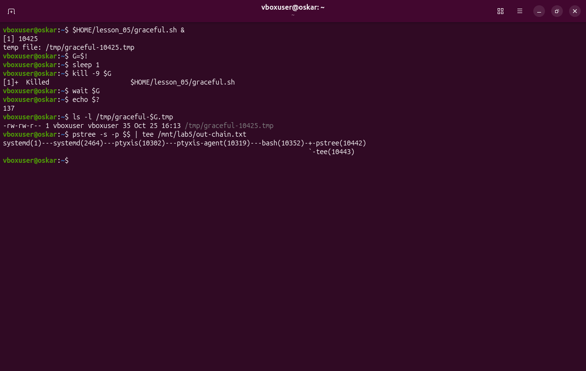
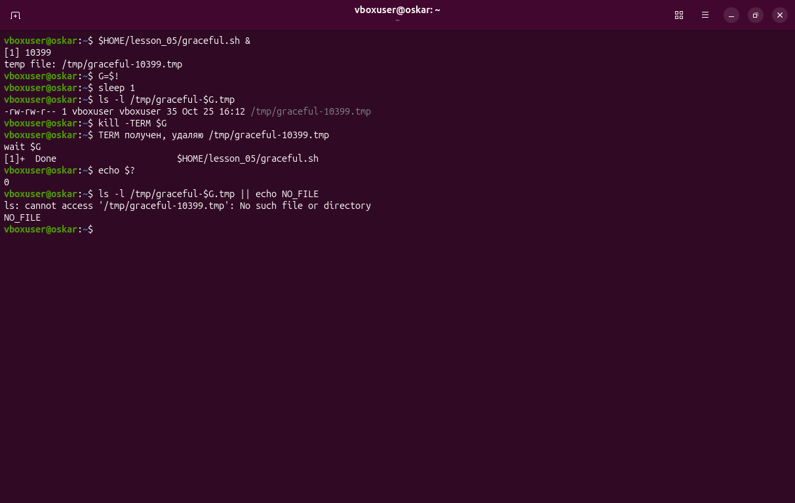
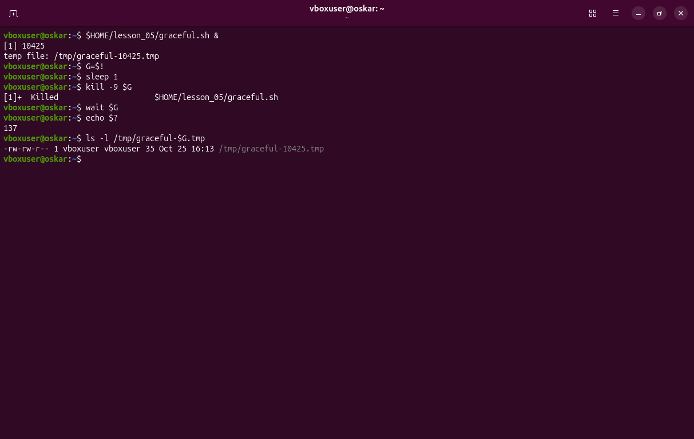

# Процессы, сигналы и коды завершения

## Цепочка от PID 1 до оболочки

Команда `pstree -s -p $$` в терминале Ptyxis:

```text
systemd(1)---systemd(2464)---ptyxis(10302)---ptyxis-agent(10319)---bash(10352)
```

| Звено | Что это |
|---|---|
| systemd (1) | первый процесс системы, его родитель — ядро, PPID 0 |
| systemd (2464) | менеджер сессии пользователя |
| ptyxis (10302) | окно терминала. В Ubuntu 26.04 это Ptyxis, не GNOME Terminal |
| ptyxis-agent (10319) | помощник терминала, от него запускается оболочка |
| bash (10352) | текущая оболочка, её PID совпадает с `$$` |

На снимке рядом с bash видны ещё `pstree` и `tee`: это сама команда, которой снята цепочка, а не постоянные родители.



## Опыт 1 — graceful.sh и SIGTERM

```bash
~/lesson_05/graceful.sh &
G=$!
kill -TERM $G
wait $G
echo $?
```

Скрипт создал `/tmp/graceful-10399.tmp`. После TERM он написал `TERM получен, удаляю /tmp/graceful-10399.tmp`, `wait` вернул `0`, повторный `ls` ответил `NO_FILE`.



## Опыт 2 — graceful.sh и SIGKILL

```bash
~/lesson_05/graceful.sh &
G=$!
kill -9 $G
wait $G
echo $?
```

Код завершения `137`. Файл `/tmp/graceful-10425.tmp` остался, права `-rw-rw-r--`.



## Коды завершения

| Код | Формула | Сигнал |
|---|---|---|
| 130 | 128 + 2 | SIGINT, Ctrl+C |
| 143 | 128 + 15 | SIGTERM |
| 137 | 128 + 9 | SIGKILL |

Эти три кода получены отдельно: Ctrl+C у `sleep 100` дал 130, `kill` дал 143, `kill -9` дал 137. Снимок — в отчёте, `screenshots/06-exit.png`.

## Разница между TERM и KILL

TERM можно перехватить через `trap`. Скрипт успевает удалить временный файл и выйти с кодом 0. KILL ядро не отдаёт процессу: обработчик не запускается, файл остаётся, код равен `128 + 9`.
