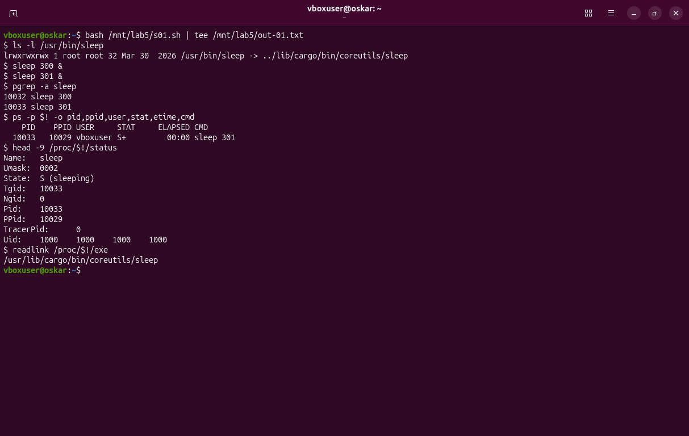
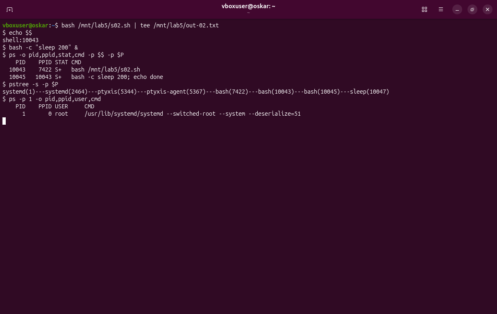
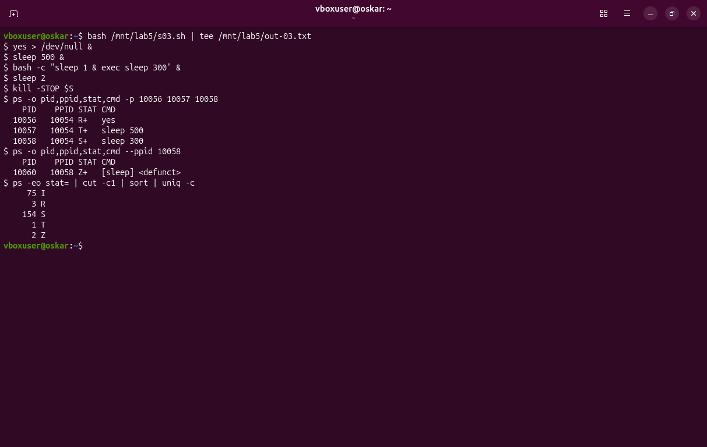
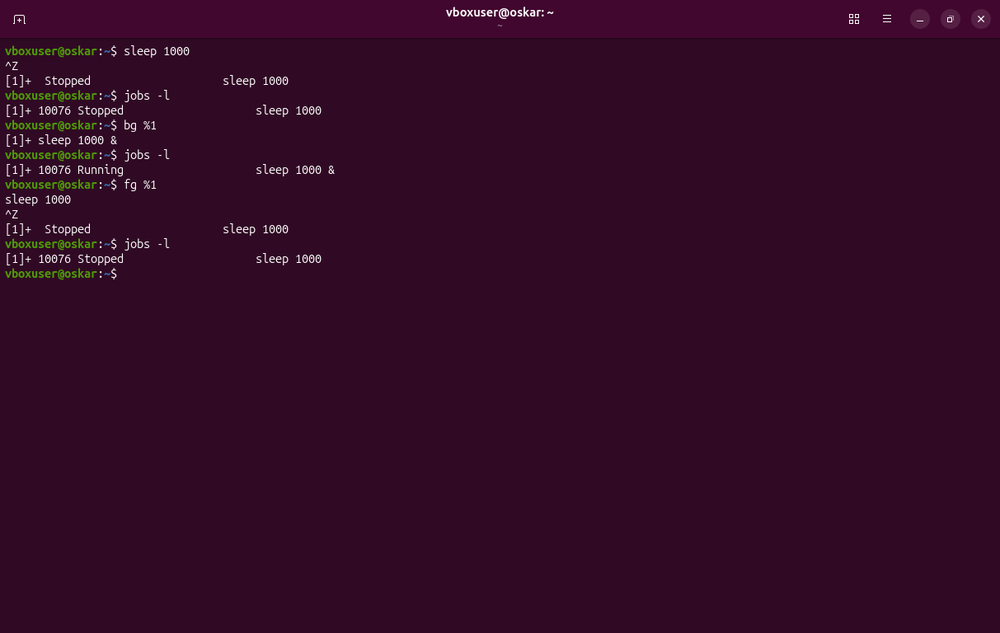
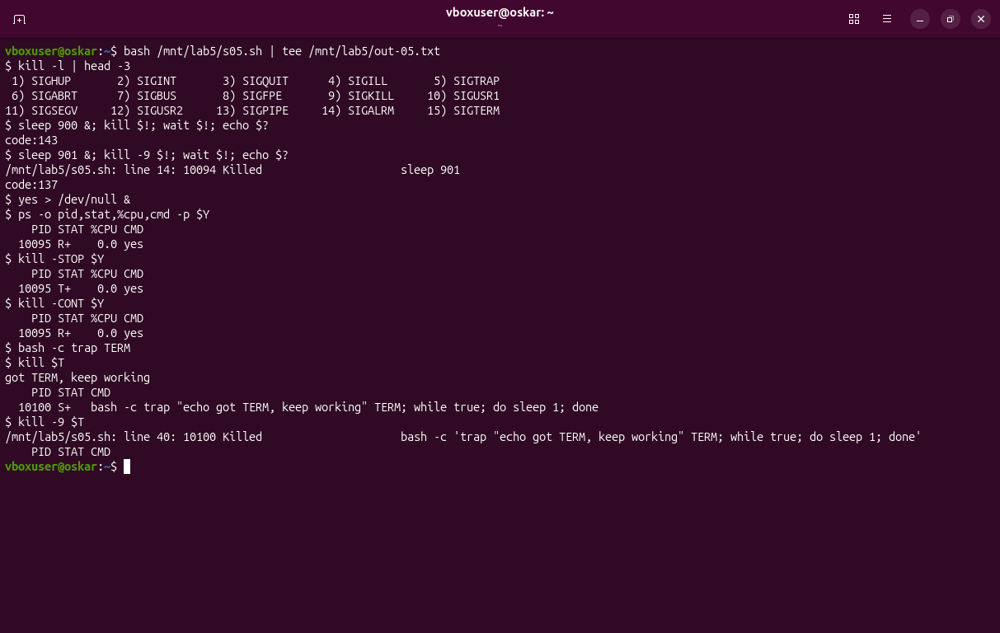
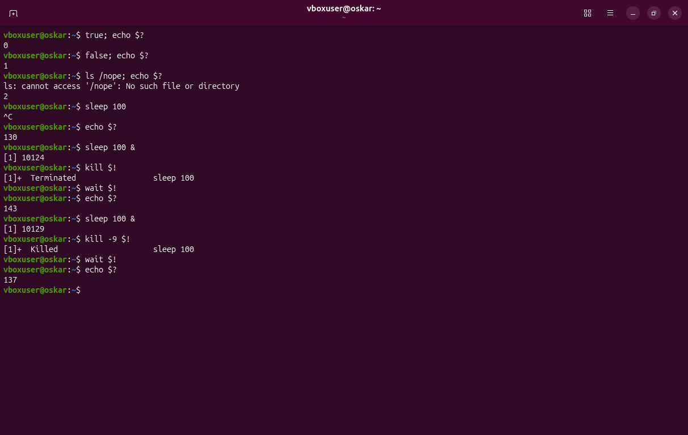
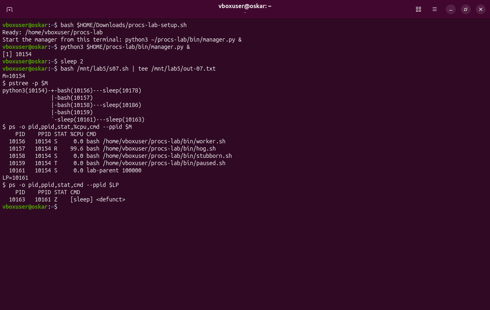
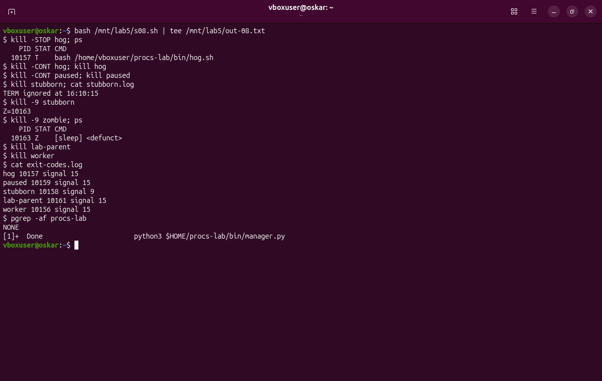
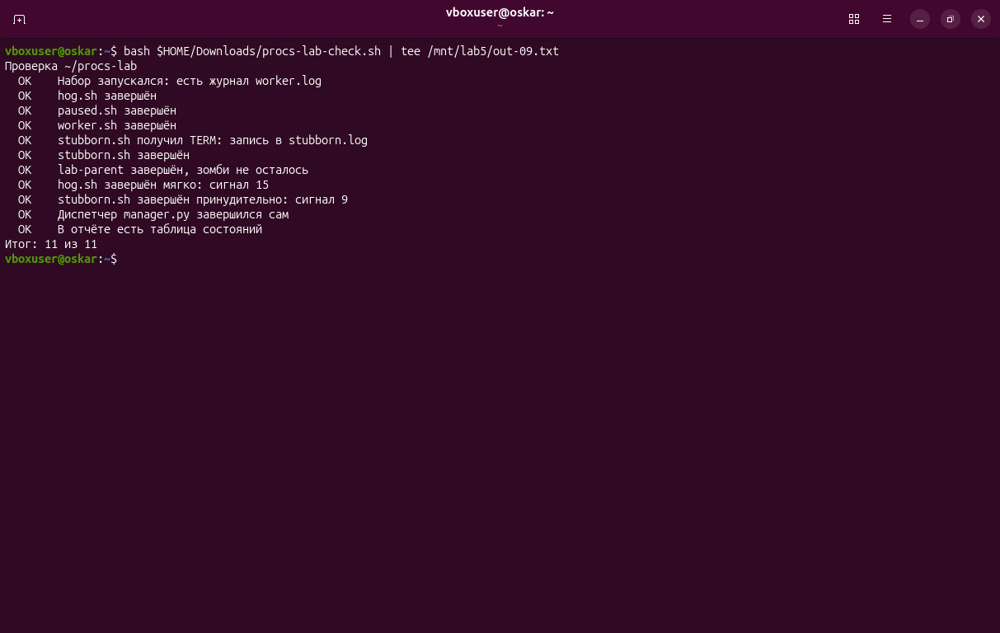

# Процессы: PID, состояния и сигналы · отчёт

ФИО: Товстенко Оскар
Группа: 9/2-РПО-25/1
Дата: 25.10.2026
Среда: Ubuntu 26.04.1 LTS, VirtualBox, пользователь `vboxuser`

## Программа и процесс

Команды:

```bash
ls -l /usr/bin/sleep
sleep 300 &
sleep 301 &
pgrep -a sleep
ps -p $! -o pid,ppid,user,stat,etime,cmd
head -9 /proc/$!/status
readlink /proc/$!/exe
```



Результат: `/usr/bin/sleep` — символьная ссылка на `../lib/cargo/bin/coreutils/sleep`. Запущенный процесс: PID `10033`, PPID `10029`, пользователь `vboxuser`, состояние `S (sleeping)`. `readlink /proc/10033/exe` дал `/usr/lib/cargo/bin/coreutils/sleep`.

Подпишите PID, PPID и состояние; чем процесс отличается от файла программы.

Вывод: файл на диске — это программа, его никто не выполняет, пока не запустят. Процесс — уже запущенный экземпляр. У него свой PID `10033`, родитель с PID `10029` и состояние `S`: он спит до конца таймера. Два запуска `sleep` получили два разных PID, хотя файл программы один.

## Дерево процессов

Команды:

```bash
echo $$
bash -c 'sleep 200; echo done' &
ps -o pid,ppid,stat,cmd -p $$ -p $!
pstree -s -p $!
ps -p 1 -o pid,ppid,user,cmd
```



Результат: `pstree` вывел

```text
systemd(1)---systemd(2464)---ptyxis(5344)---ptyxis-agent(5367)---bash(7422)---bash(10043)---bash(10045)---sleep(10047)
```

PID 1 — `/usr/lib/systemd/systemd`, PPID `0`, пользователь `root`.

Подпишите цепочку от оболочки до sleep: кто чей родитель.

Вывод: `sleep` `10047` запустил `bash -c` `10045`. Его родитель — скрипт `10043`, а того запустила оболочка терминала `7422`. Дальше вверх: агент Ptyxis, само окно Ptyxis, пользовательский systemd и systemd с PID 1. Если родитель завершается, потомка забирает процесс выше по дереву, в конце концов PID 1.

## Состояния

Команды:

```bash
yes > /dev/null &
sleep 500 &
bash -c 'sleep 1 & exec sleep 300' &
sleep 2
kill -STOP $S
ps -o pid,ppid,stat,cmd -p ...
ps -o pid,ppid,stat,cmd --ppid ...
```



Результат: `yes` — `R+`, `sleep 500` после STOP — `T+`, родительский `sleep 300` — `S+`, его потомок — `Z+` `[sleep] <defunct>`. Сводка по первой букве STAT: были и `R`, и `S`, и `T`, и `Z`.

Объясните каждое из четырёх состояний и почему появился зомби.

Вывод: `R` — процесс считается выполняющимся, `yes` крутится без остановки. `S` — спит, как `sleep`, пока не кончится время. `T` — остановлен сигналом STOP, планировщик его не берёт. `Z` — процесс уже завершился, но родитель не вызвал `wait`, поэтому запись с кодом завершения осталась. Здесь родитель сделал `sleep 1 &` и сразу заменил себя на долгий `sleep`, так что короткий потомок стал зомби.

## Фон и передний план

Команды:

```bash
sleep 1000
jobs -l
bg %1
jobs -l
fg %1
```



Результат: `sleep 1000` занял терминал. Ctrl+Z остановил задание `[1]+ 10076`. `bg %1` продолжил его в фоне, в `jobs` появилось `Running` и знак `&`. `fg %1` снова поставило его на передний план, следующий Ctrl+Z опять показал `Stopped`.

Что делает с заданием каждое действие.

Вывод: без `&` задание на переднем плане, оболочка ждёт его и не читает новые команды. Ctrl+Z посылает STOP и возвращает приглашение. `bg` шлёт CONT и оставляет задание в фоне. `fg` возвращает его на передний план, оболочка снова ждёт. Номер задания в этой сессии был `%1`, PID `10076`.

## STOP, CONT и trap

Команды:

```bash
kill -l | head -3
sleep 900 &
kill $!; wait $!; echo $?
sleep 901 &
kill -9 $!; wait $!; echo $?
yes > /dev/null &
kill -STOP $!
kill -CONT $!
bash -c 'trap "echo got TERM, keep working" TERM; while true; do sleep 1; done' &
kill $!
kill -9 $!
```



Результат: в списке сигнал 2 — SIGINT, 9 — SIGKILL, 15 — SIGTERM. `wait` после TERM дал `143`, после KILL — `137`. `yes` был `R`, после STOP стал `T`, после CONT снова `R`. Процесс с `trap` написал `got TERM, keep working` и остался в состоянии `S`. `kill -9` его снял, повторный `ps` уже пустой.

Почему процесс пережил TERM и не пережил KILL.

Вывод: TERM — обычный сигнал, программа может поставить на него `trap` и не завершаться. KILL процессорная ловушка не получает: ядро убирает процесс само. STOP и CONT при этом не завершают процесс, а только ставят на паузу и снимают с неё.

## Коды завершения

Команды:

```bash
true; echo $?
false; echo $?
ls /nope; echo $?
sleep 100
echo $?
sleep 100 &
kill $!; wait $!; echo $?
sleep 100 &
kill -9 $!; wait $!; echo $?
```



Результат: `true` — `0`, `false` — `1`, `ls /nope` — `2`. Ctrl+C у `sleep 100` дал `130`. `kill` дал `143`, в строке задания было `Terminated`. `kill -9` дал `137`, в строке было `Killed`.

Объясните коды 130, 143 и 137.

Вывод: обычный успех — 0, своя ошибка программы — небольшое число вроде 1 или 2. Если процесс снят сигналом, bash показывает `128 + номер сигнала`. 130 = 128 + 2, это SIGINT от Ctrl+C. 143 = 128 + 15, это SIGTERM. 137 = 128 + 9, это SIGKILL.

## Набор процессов

Команды:

```bash
bash ~/Downloads/procs-lab-setup.sh
python3 ~/procs-lab/bin/manager.py &
sleep 2
pstree -p $M
ps -o pid,ppid,stat,%cpu,cmd --ppid $M
ps -o pid,ppid,stat,cmd --ppid $(pgrep -f lab-parent)
```



Результат: диспетчер `python3` PID `10154`. Потомки: worker `10156` `S`, hog `10157` `R` и 99.6% CPU, stubborn `10158` `S`, paused `10159` `T`, lab-parent `10161` `S`. Его потомок `10163` — `Z`.

Таблица «процесс — состояние» для набора.

Вывод: таблица с этими PID записана в `states.md`. Буквы совпали с ролями набора: спящие worker и stubborn, занятый hog, остановленный paused и зомби у lab-parent.

## Сигналы по заданиям

Команды:

```bash
kill -STOP hog; ps
kill -CONT hog; kill hog
kill -CONT paused; kill paused
kill stubborn; cat ~/procs-lab/stubborn.log
kill -9 stubborn
kill -9 zombie; ps
kill lab-parent
kill worker
cat ~/procs-lab/exit-codes.log
pgrep -af procs-lab
```



Результат: hog после STOP был `T`, в журнале `hog 10157 signal 15`. stubborn записал `TERM ignored at 16:10:15` и затем `stubborn 10158 signal 9`. Зомби `10163` после `kill -9` остался `Z` и исчез вместе с lab-parent (`signal 15`). worker тоже `signal 15`. `pgrep` вывел `NONE`, диспетчер сам написал `Done`.

Какой сигнал выбран для каждого процесса и почему.

Вывод: hog и paused и worker завершены TERM, сигнал 15: они его не перехватывают, KILL не нужен. stubborn от TERM отказался, поэтому снят KILL, сигнал 9. Зомби сигналом не убирается, его снимает завершение родителя. Диспетчер дождался всех потомков и вышел сам.

## Проверка

Команды:

```bash
bash ~/Downloads/procs-lab-check.sh
```



Результат: `Итог: 11 из 11`.

Итог проверки; какие пункты потребовали исправления

Вывод: набор, журнал и сигналы сошлись сразу: hog записан как signal 15, stubborn как signal 9, процессов набора не осталось. Первый запуск проверки показал 10 из 11 из-за чужого зомби `[xdg-terminal-ex]` у окна терминала, не у lab-parent. Когда этого зомби не стало, тот же скрипт по тем же журналам вывел 11 из 11. Исправлять сигналы набора не пришлось.

## Перед сдачей

- [+] Проверка: 11 из 11.
- [+] Под каждым снимком есть вывод.
- [+] states.md заполнен.
- [+] Для кодов 130, 143 и 137 указан сигнал.
- [+] Процессов набора не осталось.

Скрипт `graceful.sh`, коды двух его запусков и цепочка от PID 1 — в `processes.md`.
