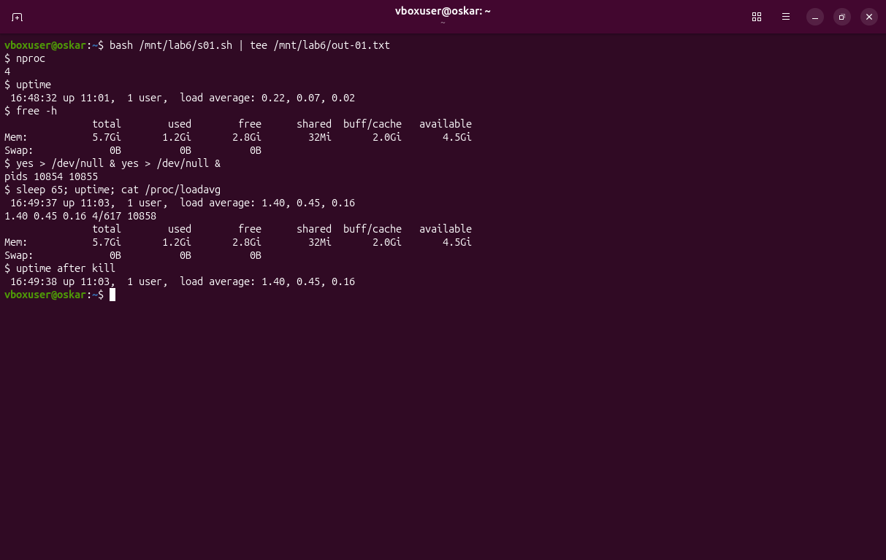
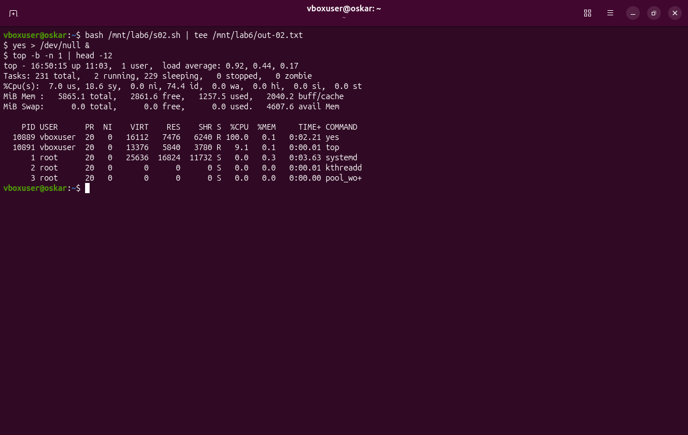
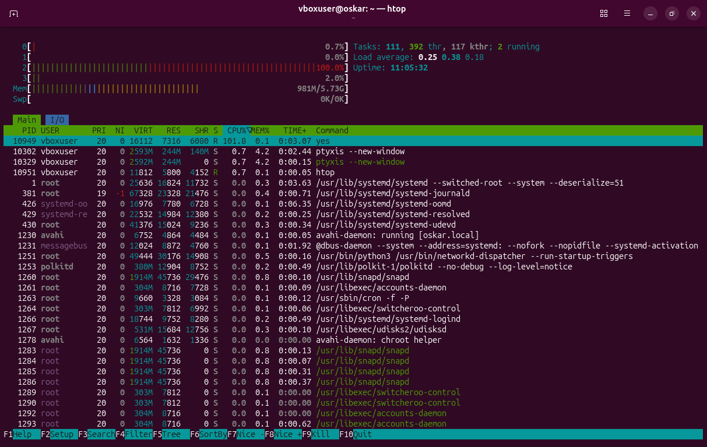
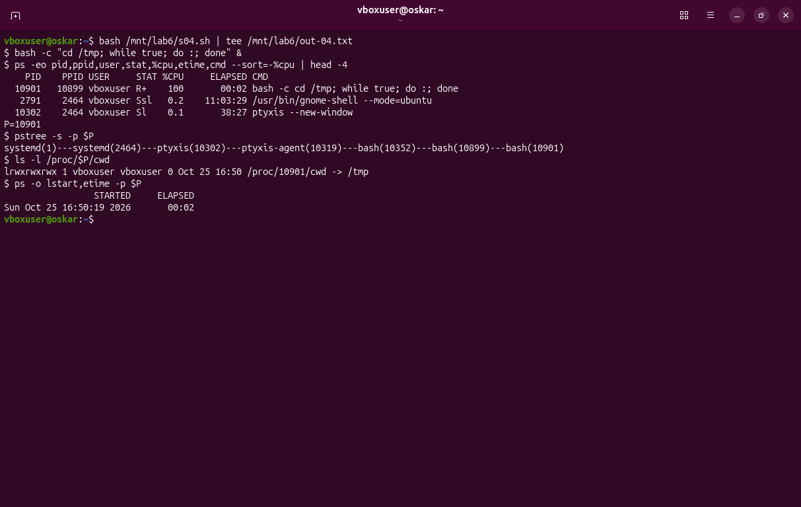
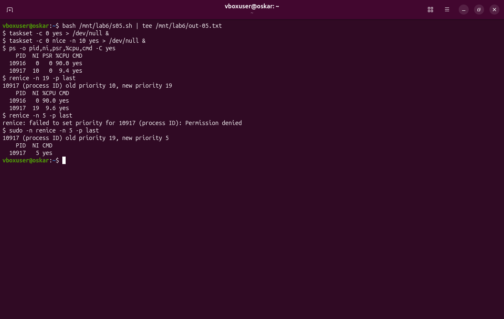
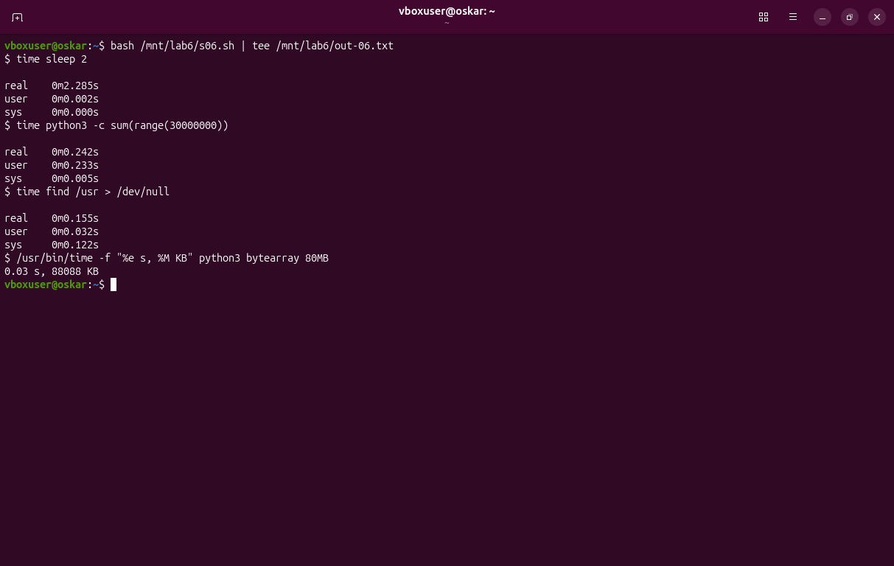
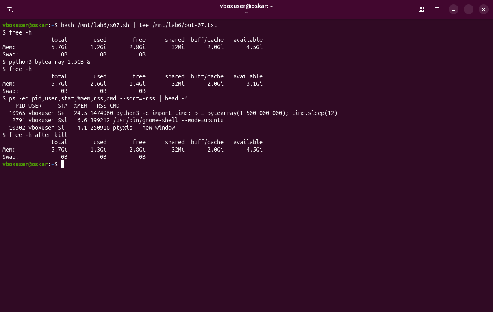
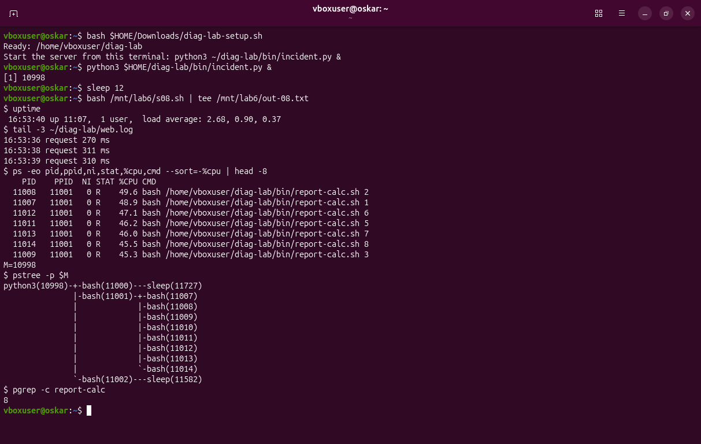
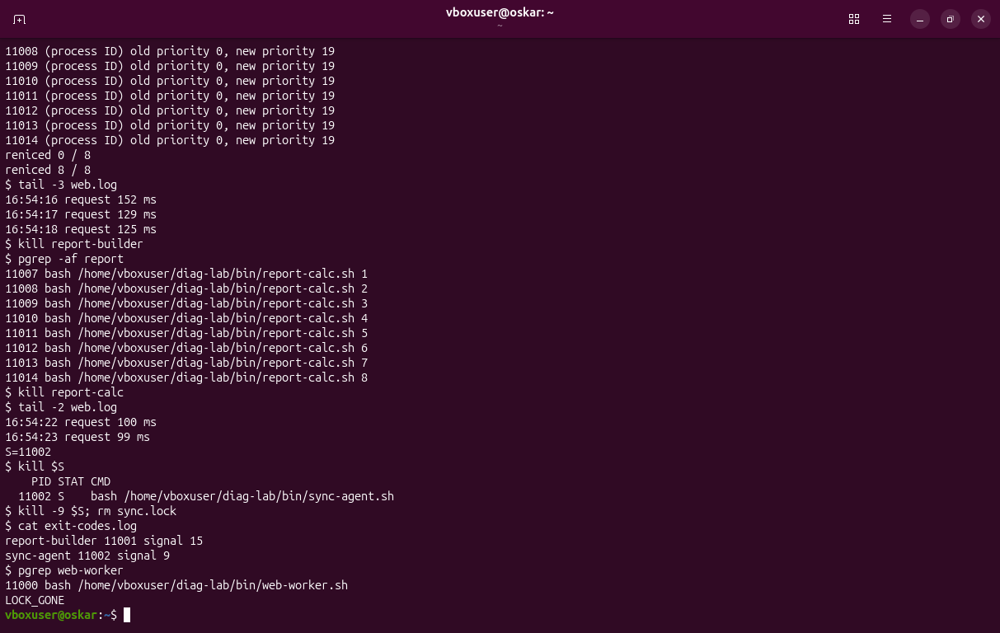
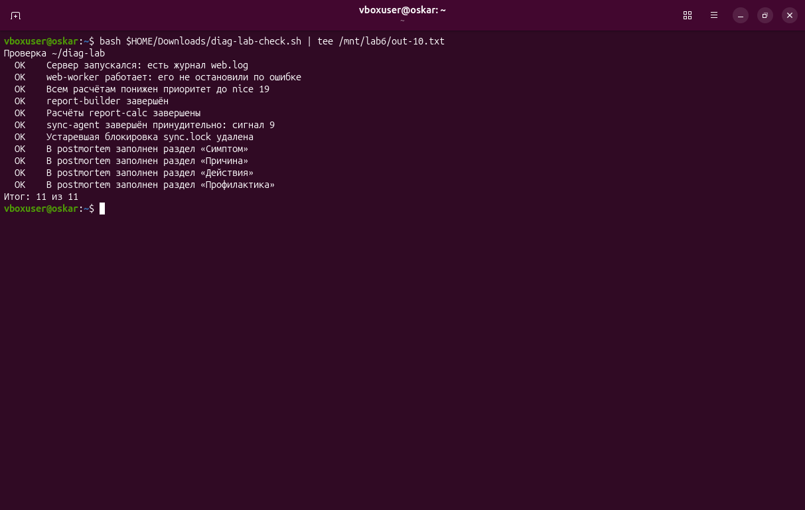

# Диагностика процессов и управление ресурсами · отчёт

ФИО: Товстенко Оскар
Группа: 9/2-РПО-25/1
Дата: 25.10.2026
Среда: Ubuntu 26.04.1 LTS, VirtualBox, пользователь `vboxuser`

## Нагрузка

Команды:

```bash
nproc
uptime
free -h
yes > /dev/null &
yes > /dev/null &
sleep 65
uptime
cat /proc/loadavg
free -h
kill 10854 10855
uptime
```



Результат: ядер 4. До запуска `yes` load average был 0.22, 0.07, 0.02. Память: 5.7 Gi всего, занято 1.2 Gi, доступно 4.5 Gi, swap нет. Два процесса `yes` (PID 10854 и 10855) за 65 секунд подняли нагрузку до 1.40, 0.45, 0.16. В `/proc/loadavg` то же самое: `1.40 0.45 0.16 4/617 10858`. Память не изменилась. Сразу после `kill` минутная средняя всё ещё 1.40.

Сравните load average с числом ядер до и после запуска yes.

Вывод: два занятых процесса на четырёх ядрах — это половина машины, и за минуту средняя успела дойти до 1.40, а не до 2. Пяти-, десяти- и пятнадцатиминутные средние (0.45 и 0.16) отстают ещё сильнее. Сразу после остановки минутная цифра не падает: в неё входят последние 60 секунд.

## top

Команды:

```bash
yes > /dev/null &
top -b -n 1 | head -12
```



Результат: load average 0.92, 0.44, 0.17. Задач 231, из них 2 running. `%Cpu(s)`: 7.0 us, 18.6 sy, 74.4 id. Память 5865.1 MiB, свободно 2861.6, доступно 4607.6. Самый загруженный процесс — `yes`, PID 10889, состояние R, 100.0 % CPU.

Подпишите нагрузку, долю us и самый загруженный процесс.

Вывод: `yes` занимает одно ядро целиком, поэтому в его строке 100 %, а по всей машине простой около 74 %: остальные три ядра свободны. Доля sy больше us, потому что процесс всё время пишет в `/dev/null`. Нагрузка 0.92 — это ещё остывающая минутная средняя после предыдущих `yes`, а не четыре занятых ядра.

## htop

Команды:

```bash
htop
```



Результат: четыре полосы ядер — 0.7 %, 0.0 %, 100.0 % и 2.0 %. Память 981M из 5.73G, swap 0. Load average 0.25, 0.38, 0.18, задач 111 (392 потока), running — 2. Зелёная строка — `yes`, PID 10949, состояние R, 101.8 % CPU и 0.1 % памяти.

Что показывают полосы ядер и памяти.

Вывод: каждая полоса — своё ядро. Занято ровно одно, на 100 %, остальные почти пустые. Полоса Mem короткая: `yes` память почти не берёт. Внизу видно, что сам `htop` стоит 0.7 % CPU, то есть картина процесса не прячется за инструментом, которым её смотрят.

## Поиск виновника

Команды:

```bash
bash -c 'cd /tmp; while true; do :; done' &
ps -eo pid,ppid,user,stat,%cpu,etime,cmd --sort=-%cpu | head -4
pstree -s -p 10901
ls -l /proc/10901/cwd
ps -o lstart,etime -p 10901
```



Результат: виновник — PID 10901, PPID 10899, пользователь `vboxuser`, состояние R+, 100 % CPU, работает 2 секунды. Команда: `bash -c cd /tmp; while true; do :; done`. Цепочка: `systemd(1) — systemd(2464) — ptyxis(10302) — ptyxis-agent(10319) — bash(10352) — bash(10899) — bash(10901)`. Каталог `/proc/10901/cwd` указывает на `/tmp`. Старт: Sun Oct 25 16:50:19 2026.

PID виновника, кто его запустил и где он работает.

Вывод: сортировка `ps` по `%cpu` сразу вытаскивает цикл наверх. Родитель — оболочка 10899, а выше по дереву терминал Ptyxis. Рабочий каталог `/tmp` подтверждает, что процесс выполнил `cd` до цикла, а не остался в домашнем каталоге.

## nice и renice

Команды:

```bash
taskset -c 0 yes > /dev/null &
taskset -c 0 nice -n 10 yes > /dev/null &
ps -o pid,ni,psr,%cpu,cmd -C yes
renice -n 19 -p 10917
renice -n 5 -p 10917
sudo -n renice -n 5 -p 10917
```



Результат: оба `yes` сидят на ядре 0 (колонка PSR). PID 10916 с nice 0 забирает 90.0 % CPU, PID 10917 с nice 10 — 9.4 %. `renice -n 19` прошёл: у 10917 приоритет сменился с 10 на 19, доля CPU осталась около 9.6 %. `renice -n 5` без прав ответил `Permission denied`. Та же команда через `sudo -n` прошла: приоритет с 19 стал 5.

Почему ядро разделилось 90 на 10 и почему renice отказал.

Вывод: на одном ядре планировщик отдаёт больше времени процессу с меньшим nice. Обычный пользователь может только повышать nice, то есть понижать себе приоритет. Понизить nice (поставить 5 вместо 19) может только root, поэтому первая попытка получила отказ, а `sudo` — нет.

## time

Команды:

```bash
time sleep 2
time python3 -c "sum(range(30_000_000))"
time find /usr > /dev/null
/usr/bin/time -f "%e s, %M KB" python3 -c "b = bytearray(80_000_000)"
```



Результат:

| Команда | real | user | sys |
|---|---|---|---|
| `sleep 2` | 2.285 с | 0.002 с | 0.000 с |
| `python3` сумма 30 млн | 0.242 с | 0.233 с | 0.005 с |
| `find /usr` | 0.155 с | 0.032 с | 0.122 с |

`/usr/bin/time` для массива на 80 МБ: `0.03 s, 88088 KB`.

Соотношение real, user и sys для каждой команды.

Вывод: у `sleep` real около двух секунд, а user и sys почти нули — процесс ждал, а не считал. У суммы почти весь real ушёл в user: это счёт в программе. У `find` больше sys, чем user: время ушло в ядро, на чтение каталогов. Отдельный `/usr/bin/time` добавляет к секундам пик памяти: массив на 80 МБ занял 88088 KB.

## Память

Команды:

```bash
free -h
python3 -c "import time; b = bytearray(1_500_000_000); time.sleep(12)" &
free -h
ps -eo pid,user,stat,%mem,rss,cmd --sort=-rss | head -4
kill 10965
free -h
```



Результат: до запуска занято 1.2 Gi, доступно 4.5 Gi. Процесс PID 10965 в состоянии S+ взял 24.5 % памяти, RSS 1 474 960 KB (около 1.4 Gi). В этот момент `free` показал занято 2.6 Gi и доступно 3.1 Gi. Следующие по RSS — `gnome-shell` (399 212 KB) и `ptyxis` (250 916 KB). После `kill` снова занято 1.3 Gi и доступно 4.5 Gi.

Сколько памяти занял процесс и вернулась ли она.

Вывод: процесс забрал примерно полтора гигабайта, и `available` просел на те же 1.4 Gi. После завершения память вернулась. Размер был безопасен: свободно было 4.5 Gi, swap в машине нет, до него дело не дошло.

## Инцидент: симптом

Команды:

```bash
bash ~/Downloads/diag-lab-setup.sh
python3 ~/diag-lab/bin/incident.py &
sleep 12
uptime
tail -3 ~/diag-lab/web.log
ps -eo pid,ppid,ni,stat,%cpu,cmd --sort=-%cpu | head -8
pstree -p 10998
pgrep -c -f diag-lab/bin/report-calc.sh
```



Результат: сервер поднят из этого терминала, `incident.py` получил PID 10998. Через несколько секунд load average стал 2.68, 0.90, 0.37. В начале `web.log` запросы шли 233 и 236 мс, на снимке уже 270, 311 и 310 мс. В `ps` сверху процессы `report-calc` в состоянии R, примерно по 45–50 % CPU, родитель у всех — 11001. `pstree` показывает: `web-worker` (11000) спит в `sleep`, `report-builder` (11001) держит восемь `report-calc` (11007–11014), `sync-agent` (11002) тоже жив. `pgrep` насчитал 8 расчётов. `web-worker` при этом не падал.

Симптом в числах и виновники.

Вывод: сайт замедлился не потому, что упал worker, а потому что рядом считали восемь циклов — по два на каждое из четырёх ядер. Нагрузка 2.68, а не 8, потому что циклы работали меньше минуты и средняя ещё не догнала их число.

## Инцидент: исправление

Команды:

```bash
renice -n 19 -p 11007 11008 11009 11010 11011 11012 11013 11014
tail -3 ~/diag-lab/web.log
kill 11001
kill 11007 11008 11009 11010 11011 11012 11013 11014
kill 11002
kill -9 11002
rm -f ~/diag-lab/sync.lock
cat ~/diag-lab/exit-codes.log
```



Результат: у всех восьми calc приоритет сменился с 0 на 19, в журнале набралось `reniced 8 / 8`. Пример строки из `report.log`: `16:54:16 calc 7 pid 11013 nice=19`. Время ответа упало до 152, 129 и 125 мс. `kill` builder завершил его (в `exit-codes.log` — `report-builder 11001 signal 15`), но все восемь calc остались в списке процессов. Их остановил отдельно, и запросы стали 100 и 99 мс. `sync-agent` (PID 11002) после обычного `kill` остался в состоянии S. `kill -9` записал `sync-agent 11002 signal 9`, файл `sync.lock` исчез (`LOCK_GONE`). `web-worker` PID 11000 на месте.

Что сделано и как изменилось время ответа.

Вывод: понижение приоритета уже вернуло сайту часть скорости (с ~310 мс к ~130 мс), а остановка расчётов довела ответ до ~100 мс. Детей пришлось убивать отдельно от родителя. Процесс с пустым `trap` на TERM обычный `kill` не берёт, его снимает только сигнал 9. Worker я не трогал: иначе проверка решила бы, что сайт остановлен по ошибке.

## Проверка

Команды:

```bash
bash ~/Downloads/diag-lab-check.sh
```



Результат: все 11 пунктов `OK`. Итог: 11 из 11. Повторять проверку не пришлось: расчёты успели записать `nice=19`, builder и calc были завершены, `sync-agent` снят сигналом 9, блокировка удалена, worker ещё работал, в `postmortem.md` заполнены все четыре раздела.

Итог проверки; какие пункты потребовали исправления.

Вывод: с первого запуска проверка сошлась. После снимка сервер остановлен, чтобы `web-worker` не оставался в машине. Разбор инцидента — в `postmortem.md`.

## Перед сдачей

- [+] Проверка: 11 из 11.
- [+] Под каждым снимком есть вывод.
- [+] postmortem.md заполнен.
